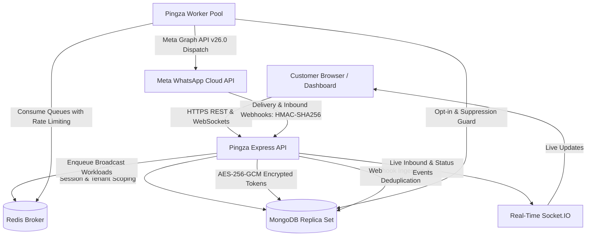

# Pingza Architecture & System Design

## 1. System Topology & Monorepo Structure

Pingza is a multi-tenant WhatsApp Marketing SaaS platform organized as a high-performance pnpm monorepo. It features strict separation of concerns between user-facing interfaces, REST API services, asynchronous background workers, and shared core packages:

```
whatsapp-marketing-saas/
├── apps/
│   ├── web/                     # React 18 + Vite + MUI Customer Dashboard & Workflows
│   ├── api/                     # Express.js REST API with rate-limiting, RBAC, and encryption
│   └── worker/                  # Standalone background worker process for campaign delivery
├── packages/
│   ├── contracts/               # Shared Zod schemas, API request/response envelopes, and DTOs
│   ├── domain/                  # Core domain entities, business validation rules, and status enums
│   ├── database/                # Mongoose connection handling, models, repositories & tenant query scoping
│   ├── whatsapp-adapter/        # Meta Cloud API adapter interface, token debug, and webhook verification
│   └── billing/                 # Plan tier definitions, quota limits, and usage tracking
├── docs/                        # Operational guides, security reviews, and architecture documentation
└── tests/                       # Automated test suites, integration fixtures, and mocks
```

---

## 2. Component Architecture & Workflow



---

## 3. Subsystem Breakdown

### 1. `apps/web` (Frontend Application)
- **Framework:** React 18, TypeScript, Vite, Material UI (MUI v6), TanStack Query.
- **Navigation & Layout:** Responsive drawer sidebar, header with workspace switcher, theme toggle, and account status indicators.
- **Embedded Signup v4:** Facebook Login for Business with `config_id`, origin-verified postMessage session listeners, and zero token exposure to browser storage.
- **Interactive Modules:**
  - **WhatsApp Business Accounts (`/whatsapp-accounts`):** Connect with official Meta Embedded Signup v4, live quality rating, sync, disconnect, and business profile modal.
  - **Live WhatsApp Inbox (`/conversations`):** Real-time chat threads, 2-way text and media messaging, message delivery/read checks, canned quick reply shortcut picker, and approved template messaging.
  - **Message Templates (`/templates`):** Full authoring studio, category selection, language management, dynamic variable preview, and approval status syncing.
  - **Broadcast Campaigns (`/campaigns`):** Campaign creation wizard, audience filtering, template parameter substitution, scheduling, and live delivery telemetry.
  - **Contact Directory (`/contacts`):** E.164 phone normalization, opt-in/opt-out status, suppression management, tags, and CSV bulk import/export.

### 2. `apps/api` (REST API Gateway)
- **Framework:** Node.js, Express, TypeScript.
- **Security:** Helmet security headers, Argon2id password hashing, rotating JWT access/refresh tokens with reuse detection.
- **Multi-Tenant Protection:** `requireAuth` and `requireWorkspace(minRole)` middleware validating tenant membership and role hierarchy before any handler execution.
- **Webhook Gateway:** Cryptographic HMAC-SHA256 signature verification over raw payload, atomic MongoDB deduplication, and routing to message threads and chatbot automations.
- **Token Security:** Authenticated AES-256-GCM encryption with unique 12-byte IVs and 16-byte auth tags. Plaintext credentials are never returned in API responses or logs.

### 3. `packages/whatsapp-adapter` (Meta Provider Abstraction)
- `WhatsAppAdapter` contract abstracts all Meta Graph API interactions.
- `MetaWhatsAppCloudAdapter`: Production implementation targeting Meta Graph API (v26.0) with timeout guards and error sanitization.
- `MockWhatsAppAdapter`: Zero-dependency testing adapter supporting deterministic test runs and local sandbox simulation.

### 4. `apps/worker` (Background Campaign Engine)
- Dedicated Node.js background process utilizing Redis and BullMQ.
- Executes bulk broadcast dispatches with configurable per-second throughput limits.
- Immediately verifies contact opt-in consent and suppression lists prior to dispatch.
- Atomic state updates tracking accepted, sent, delivered, read, and failed delivery counters.

---

## 4. Multi-Tenant Isolation Model

Logical tenant isolation is guaranteed at every layer:
1. **Workspace Boundary:** Every customer belongs to one or more `Workspaces`.
2. **Server-Side Verification:** Route handlers never trust client-supplied tenant identifiers. All queries are filtered through the verified `workspaceId` extracted from the server-validated membership.
3. **Database Scoping & Indexing:** All tenant collections feature compound indexes starting with `workspaceId`.
4. **Phone Hijacking Protection:** MongoDB partial unique index prevents a WhatsApp phone number ID from being active in more than one workspace concurrently.
