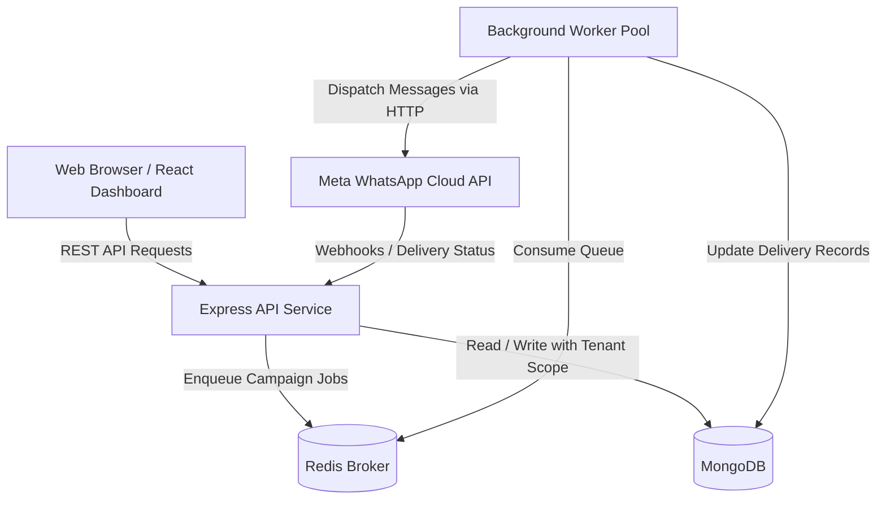

# Architecture Document

## 1. Monorepo Structure

The project is structured as a pnpm workspace with strict boundaries between user-facing applications, backend microservices, and reusable domain libraries:

```
whatsapp-marketing-saas/
├── apps/
│   ├── web/                     # React + Vite + MUI Customer & Admin Dashboard Shell
│   ├── api/                     # Express.js REST API with security headers, logging & health probes
│   └── worker/                  # Standalone background worker process for asynchronous queue workloads
├── packages/
│   ├── contracts/               # Shared Zod schemas, API request/response envelopes, and DTOs
│   ├── domain/                  # Pure domain entities, business validation rules, and status enums
│   ├── database/                # Mongoose connection handling, lifecycle logging, and tenant query scoping
│   ├── whatsapp-adapter/        # Meta Cloud API adapter interface and webhook event payloads
│   └── billing/                 # Plan tier definitions, quota limits, and Stripe usage records
├── infrastructure/
│   └── docker/                  # Docker Compose configuration for local MongoDB and Redis
├── docs/                        # Complete architectural and operational specifications
└── tests/                       # Global testing harness and test runner setup
```

---

## 2. Component Roles & Communication



### 1. `apps/web` (Frontend Dashboard)
- Built with React 18, TypeScript, Vite, Material UI (MUI v6), and TanStack Query.
- Responsive layout featuring desktop drawer, mobile drawer, top navigation bar, and breadcrumbs.
- Standalone resilience: Gracefully operates in interactive demo mode when API or database services are offline.

### 2. `apps/api` (REST API Gateway)
- Express.js application decoupled across `app.ts` (factory) and `server.ts` (bootstrap).
- Enforces correlation IDs (`X-Request-Id`), Helmet security headers, CORS origin restrictions, body payload size bounds, and centralized error envelopes.
- Health checks: Liveness (`/health`) and real dependency readiness (`/health/ready`).

### 3. `apps/worker` (Background Job Processor)
- Dedicated Node.js process decoupled from HTTP request handling.
- Executes heavy, asynchronous workloads via Redis-backed BullMQ queues.
- Designed with graceful shutdown to drain active jobs before termination.

---

## 3. Multi-Tenant Isolation Strategy

Logical tenant isolation is implemented across every layer:
1. **Workspace Boundary**: Every business tenant operates within a dedicated `Workspace`.
2. **Database Scoping**: All tenant-owned collections (`contacts`, `whatsapp_accounts`, `templates`, `campaigns`, `messages`) include an immutable `workspaceId` index.
3. **Server-Side Verification**: Route handlers never trust client-supplied tenant identifiers in route params or body payloads. All queries are filtered through the verified `workspaceId` extracted from the server-validated JWT claim.

---

## 4. Background Job Architecture (BullMQ)

High-volume WhatsApp broadcasting requires decoupled asynchronous job execution:
- **Campaign Dispatch Queue (`whatsapp-campaign-dispatch`)**: Partitions campaign recipients into 500-recipient batch chunks.
- **Message Transmission Queue (`whatsapp-message-transmission`)**: Workers dispatch messages to Meta's Cloud API endpoints respecting the tenant's current Meta rate-limiting tier (Tier 1: 80 msgs/sec, Tier 2: 250 msgs/sec).
- **Webhook Processing Queue (`whatsapp-webhook-processing`)**: Ingests incoming status updates (`sent`, `delivered`, `read`, `failed`) and updates telemetry counters without blocking the Meta webhook endpoint.
