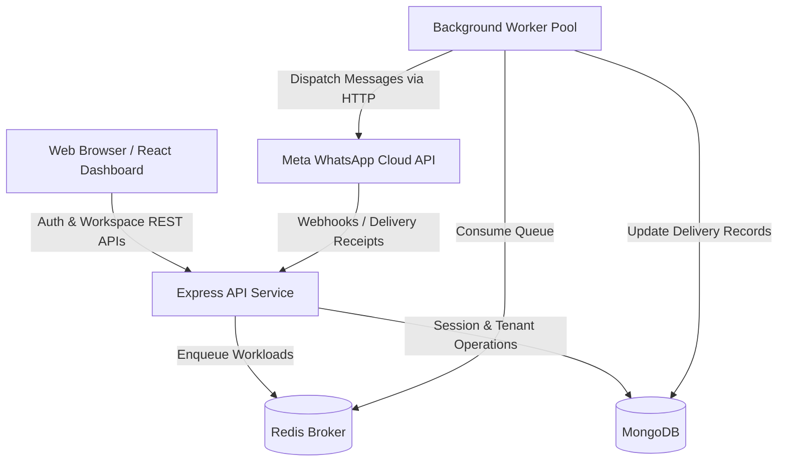

# Architecture Document

## 1. Monorepo Structure

The project is structured as a pnpm workspace with strict boundaries between user-facing applications, backend microservices, and reusable domain libraries:

```
whatsapp-marketing-saas/
├── apps/
│   ├── web/                     # React 18 + Vite + MUI Customer Dashboard Shell & Auth Pages
│   ├── api/                     # Express.js REST API with security headers, logging & health probes
│   └── worker/                  # Standalone background worker process for asynchronous queue workloads
├── packages/
│   ├── contracts/               # Shared Zod schemas, API request/response envelopes, and DTOs
│   ├── domain/                  # Pure domain entities, business validation rules, and status enums
│   ├── database/                # Mongoose connection handling, models, repositories & tenant query scoping
│   ├── whatsapp-adapter/        # Meta Cloud API adapter interface and webhook event payloads
│   └── billing/                 # Plan tier definitions, quota limits, and Stripe usage records
├── infrastructure/
│   └── docker/                  # Docker Compose configuration for local MongoDB and Redis
├── docs/                        # Complete architectural and operational specifications
└── tests/                       # Global testing harness and test runner setup
```

---

## 2. Component Roles & Communication



### 1. `apps/web` (Frontend Dashboard & Customer Portal)
- Built with React 18, TypeScript, Vite, Material UI (MUI v6), and TanStack Query.
- Responsive layout featuring desktop drawer, mobile drawer, top navigation bar, and breadcrumbs.
- **Authentication**: `AuthProvider` and `useAuth` hook managing silent refresh restoration, user profile, and active workspace selection.
- **Route Guarding**: `ProtectedRoute` protects all internal dashboard views (`/`, `/contacts`, `/templates`, `/campaigns`, `/settings`, `/team`), redirecting unauthenticated users to `/login`.
- **Auth Pages**: Login, Registration, Forgot Password, Reset Password, Email Verification, Accept Invitation.
- **Team Management**: Team Members page with role management dialogs and ownership transfer controls.

### 2. `apps/api` (REST API Gateway)
- Express.js application decoupled across `app.ts` (factory) and `server.ts` (bootstrap).
- **Authentication Middleware**: `requireAuth` validates Bearer JWT access tokens and user status.
- **Tenant Middleware**: `requireWorkspace(minRole)` enforces workspace membership and role hierarchy.
- **Session Layer**: Refresh token rotation, reuse detection, and session revocation.
- **Email Service Abstraction**: `IEmailService` for verification, password reset, and invitation emails.

### 3. `apps/worker` (Background Job Processor)
- Dedicated Node.js process decoupled from HTTP request handling.
- Executes heavy, asynchronous workloads via Redis-backed BullMQ queues.
- Designed with graceful shutdown to drain active jobs before termination.

---

## 3. Multi-Tenant Isolation Strategy

Logical tenant isolation is implemented across every layer:
1. **Workspace Boundary**: Every business tenant operates within a dedicated `Workspace`.
2. **Server-Side Verification**: Route handlers never trust client-supplied tenant identifiers in route params or body payloads. All queries are filtered through the verified `workspaceId` extracted from the server-validated membership.
3. **Database Scoping**: All tenant-owned collections include an immutable `workspaceId` index and explicit scoping.
4. **IDOR Defense**: Access attempts across workspaces are blocked at middleware before any business handler is reached.
